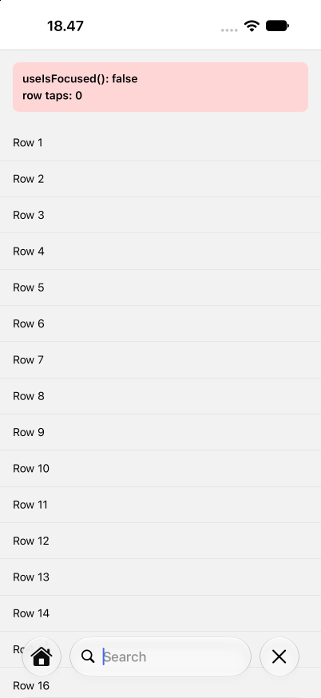
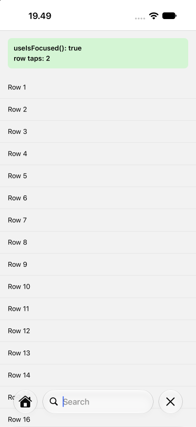

# react-native-screens: `UISearchTab` user selection dropped by a mount transaction

Minimal repro for: **[iOS][Tabs] User selection of a `UISearchTab` is dropped when a mount transaction lands before `didSelectTab:`, so JS and UIKit go out of sync.**

| 4.29.0 | 4.29.0 + `fix/rns-search-tab-selection.patch` |
|---|---|
|  |  |

## Setup

- react-native-screens 4.29.0 (pinned via `overrides`; Expo SDK 58 resolves 4.28.0 by default)
- react-native 0.88.0-rc.3 (New Architecture), react 19.3.0
- expo ~58.0.6, expo-router 58.0.16 (`NativeTabs`)
- Xcode 27.0 (27A266a), iPhone 18 Pro simulator, iOS 27.0

`.npmrc` sets `legacy-peer-deps=true` because react-native-reanimated's peer range (`0.86 - 0.88`) rejects `0.88.0-rc.3`. This has nothing to do with the bug.

```sh
npm install
npx expo run:ios
```

## The app

- `src/app/_layout.tsx`: `NativeTabs` with a Home tab and a search tab. The search tab gets `unstable_nativeProps={{ ios: { role: 'search', automaticallyActivatesSearch: true } }}`. expo-router's `role="search"` alone only sets `systemItem: 'search'`, which gives a plain `UITab`.
- `src/app/search/`: a `Stack` with `headerSearchBarOptions` and a `FlatList`. A banner shows `useIsFocused()` and counts row taps.

## Steps

1. Tap the Search tab. The search field activates and the other tabs collapse into a Home button on the left.
2. Tap the collapsed Home button.
3. Tap the Search tab again.

**Actual:** from the second selection on, the search screen is visible and the search field is active, but `useIsFocused()` is `false`. expo-router renders unfocused tab screens with `pointerEvents="none"`, so the list can't be scrolled and row taps aren't counted. The first selection after launch works.

**Expected:** every user selection of the search tab sends `onTabSelected`, and JS state follows UIKit.

Driving the steps with automation dropped 9 of 10 selections, with only the first one getting through.

## Why

`-performContainerUpdate` is called from `reactMountingTransactionDidMount` after every Fabric mount, and it resets `_isHandlingUserTabSelection`. For a `UISearchTab` with `automaticallyActivatesSearch`, UIKit runs the search activation transition between `tabBarController:shouldSelectTab:` and `tabBarController:didSelectTab:previousTab:`. A mount transaction lands in that gap even without app-driven updates, so the flag is cleared and `didSelectTab:` returns early as if the selection were programmatic.

## Fix

`fix/rns-search-tab-selection.patch` only clears the flag when a programmatic selection is applied (`-applySelectedScreenController:`), not on every container update.

```sh
patch -p1 -d node_modules/react-native-screens < fix/rns-search-tab-selection.patch
npx expo run:ios
```

With the patch, 20 of 20 automated selections reached JS (`useIsFocused()` was `true`) and row taps were counted, compared with 9 of 10 dropped without it.
